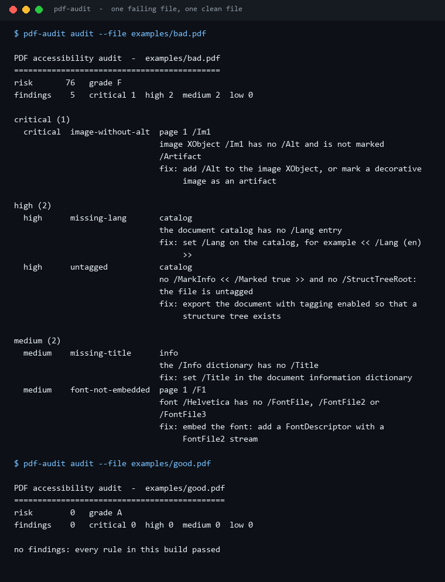
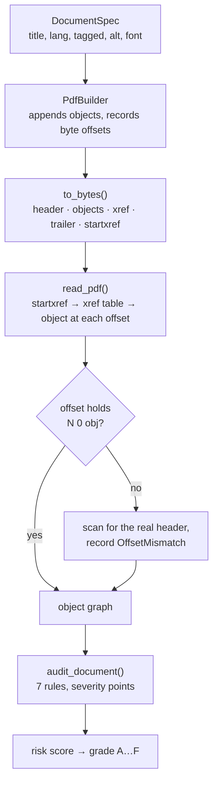
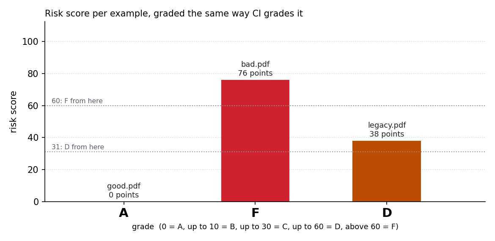
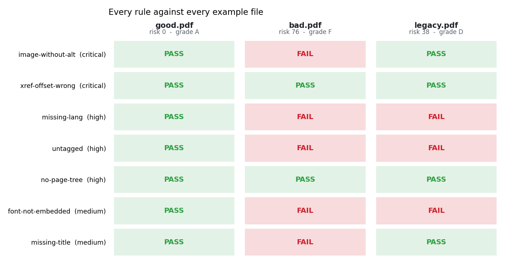

# PDF-Access-Auditor

**A PDF is a pile of byte offsets pretending to be a document: this project writes one from scratch with `zlib` and `struct`, reads it back by believing the cross-reference table, and then grades the seven accessibility basics that a structure-only reader can actually decide.**

No `pypdf`, no `Pillow`, no `matplotlib` in the package - the writer emits the header, the objects,
the xref table and the trailer by hand, and the reader re-derives every offset to prove the writer
was telling the truth.



Every number below comes from `scripts/render_assets.py` running this repository's own code.

---

## Table of contents

- [Why this exists](#why-this-exists)
- [Write, read, audit](#write-read-audit)
- [The seven rules](#the-seven-rules)
- [What the three examples score](#what-the-three-examples-score)
- [The checks matrix](#the-checks-matrix)
- [Install and run](#install-and-run)
- [Commands](#commands)
- [Notes on the PDF format](#notes-on-the-pdf-format)
- [Design notes and limits](#design-notes-and-limits)
- [Tests](#tests)
- [License](#license)

---

## Why this exists

Every other file format in this family has a parser you can trust. PDF does not: it is a random
access format with an index (the xref table) that most tools quietly ignore, because the index is
wrong often enough that "just scan for `obj`" became the normal way to read a PDF.

That is a problem for accessibility work, because the accessibility metadata lives in the object
graph - the catalog's `/Lang`, the structure tree, the image `/Alt`, the font descriptor - and the
object graph is exactly what a broken index damages. So this project does both halves:

1. **write** - emit a small PDF whose xref offsets are *measured*, not guessed;
2. **read** - parse by trusting the xref table, then check it, and report the disagreement;
3. **audit** - turn the resulting object graph into seven severity-scored findings.

## Write, read, audit



The repair path is deliberate: a reader that refuses a slightly broken file is useless, and a reader
that silently repairs one hides the defect. This one repairs *and* reports, which is the only
combination that makes `xref-offset-wrong` a real measurement.

## The seven rules

| Code | Severity | Points | It fails when |
| --- | --- | ---: | --- |
| `image-without-alt` | critical | 30 | an image XObject reachable from a page has no `/Alt` and is not marked `/Artifact` |
| `xref-offset-wrong` | critical | 30 | an in-use xref entry does not point at the byte where its object really starts |
| `missing-lang` | high | 15 | the catalog has no `/Lang` |
| `untagged` | high | 15 | there is no `/MarkInfo << /Marked true >>` **and** no `/StructTreeRoot` |
| `no-page-tree` | high | 15 | `/Root → /Pages → /Kids` cannot be walked down to a page |
| `font-not-embedded` | medium | 8 | a page's font has no `/FontFile`, `/FontFile2` or `/FontFile3` |
| `missing-title` | medium | 8 | the `/Info` dictionary has no non-empty `/Title` |

Findings are sorted by severity, then scope, then code, and the risk score is the sum of the points:
**0 = A, up to 10 = B, up to 30 = C, up to 60 = D, above 60 = F**.

## What the three examples score



| Example | What it is | Bytes | Objects | Pages | Findings | Risk | Grade |
| --- | --- | ---: | ---: | ---: | ---: | ---: | --- |
| `examples/good.pdf` | language, tagging, alt text, embedded font, title | 2590 | 13 | 2 | 0 | **0** | **A** |
| `examples/bad.pdf` | none of the above | 1093 | 7 | 1 | 5 | **76** | **F** |
| `examples/legacy.pdf` | title and alt text only, untagged, no language | 1496 | 9 | 2 | 3 | **38** | **D** |

Three files, 8 findings, 5179 bytes of committed PDFs - all three built by this repository's own
writer, which is why none of them carries an `xref-offset-wrong` finding. The failures are about
*content*, not corruption.

What `bad.pdf` is actually missing, straight out of `docs/results.json`:

| Code | Scope | Points |
| --- | --- | ---: |
| `image-without-alt` | `page 1 /Im1` | 30 |
| `missing-lang` | `catalog` | 15 |
| `untagged` | `catalog` | 15 |
| `missing-title` | `info` | 8 |
| `font-not-embedded` | `page 1 /F1` | 8 |

30 + 15 + 15 + 8 + 8 = **76**, which is past the 60 that separates D from F.

`legacy.pdf` is the interesting middle: it has a title and an alt text, so it keeps its 30-point
image finding and its 8-point title finding, and pays 15 + 15 + 8 = **38** for the missing language,
the missing structure tree and the non-embedded Helvetica. One font used by two pages is reported
once, because the finding is about the font object, not about each page that happens to use it.

## The checks matrix



`pdf-audit checks --file …` prints the same grid as text: every rule, PASS or FAIL, including the
ones that passed - a report that only lists failures cannot tell you what was actually verified.

## Install and run

Standard library only at runtime.

```bash
python -m pip install -e ".[dev]"
pdf-audit rules
```

From a checkout without installing:

```bash
PYTHONPATH=src python -m pdf_access_auditor audit --file examples/bad.pdf
```

Write a PDF and grade it in the same breath:

```bash
pdf-audit write --out demo.pdf --embed-font true --pages 3
```

```
wrote demo.pdf  2900 bytes  3 page(s)
audit  risk 0  grade A  no findings
```

Because an empty string is awkward to pass through some shells (PowerShell 5.1 silently drops
`--lang ""`), the value `none` means "leave the entry out":

```bash
pdf-audit write --out bad.pdf --lang none --title none --tagged false --alt false
```

## Commands

| Command | What it does |
| --- | --- |
| `write --out PATH [--lang L] [--title T] [--tagged true\|false] [--alt true\|false] [--embed-font true\|false] [--pages N]` | build a PDF from scratch and audit what was written (`--lang none` / `--title none` omit the entry) |
| `audit --file PATH [--format text\|markdown\|json] [--fail-on never\|critical\|high\|medium\|low]` | grade one file; exit 1 when the gate fails, 2 when the file cannot be read |
| `info --file PATH` | the structure the reader resolved: version, objects, pages, title, language, tag state |
| `checks --file PATH` | every rule with PASS/FAIL for that one file |
| `rules` | the static catalogue with severities, points and fix hints |

Exit codes are the contract: `0` passed, `1` failed the `--fail-on` gate (default `high`), `2` the
file could not be read at all.

## Notes on the PDF format

- **Header and trailer.** `%PDF-1.7`, a binary comment line so the file is never mistaken for text,
  then objects, then `xref`, `trailer`, `startxref`, `%%EOF`.
- **Xref entries are exactly 20 bytes** - `nnnnnnnnnn ggggg n \n` - because the format says the
  reader may seek by arithmetic: `entry = xref_offset + 20 * object_number`. The tests assert the
  width, not just the numbers.
- **Offsets are measured while appending.** `PdfBuilder` records `len(buffer)` immediately before
  writing each `N 0 obj`, so the table cannot drift from the bytes.
- **Streams carry a real `/Length`.** Content streams and the font file are Flate-compressed and
  declare `/Filter /FlateDecode`; the font file also declares `/Length1`, which is the
  *uncompressed* size, as the format requires.
- **Strings are UTF-8 with octal escapes.** `(`, `)`, `\` are escaped, every byte outside printable
  ASCII becomes `\ddd`, and the reader turns it back into the same text - which is stricter than
  PDFDocEncoding and much easier to round-trip in a test.

## Design notes and limits

- **The embedded font is a structural stand-in, not a real typeface.** `font_file_data()` builds a
  TrueType *container*: offset table, one `head` table, the `0x5F0F3CF5` magic number and a real
  big-endian table checksum. It has no glyphs, no `cmap` and no `glyf`, so no renderer can draw with
  it. Nothing in this project needs it to draw anything - the auditor follows the
  `/FontDescriptor → /FontFile2` chain, which is the part accessibility tools check.
- **This is a basic accessibility subset, not PDF/UA conformance.** Seven rules decided purely from
  structure. Real conformance also needs reading order, table headers, form-field tooltips, colour
  contrast, the document outline, and a human checking that the alt text is *good* rather than
  present. `grade A` here means "none of the seven defects", nothing more.
- **No cross-reference streams.** Incremental updates (`/Prev`, several xref sections) and PDF 1.5
  xref streams are rejected with a clear message rather than half-parsed. The writer never produces
  them.
- **The repair scan is a fallback, never a silent path.** If an entry does not hold `N 0 obj`, the
  reader scans for the real header and records the mismatch; if the scan cannot find the object, it
  is listed as missing instead of being invented.
- **Images are 8×8 greyscale placeholders.** The rule checks for `/Alt` and `/Artifact`, not for
  pixels, so a placeholder is enough to exercise it - and 64 bytes of deterministic ramp keeps the
  examples small.
- **Deterministic output.** Seeded by nothing, clocked by nothing: the same spec always produces the
  same bytes, which is what lets the examples be committed and diffed.

## Tests

```bash
PYTHONPATH=src python -m pytest -q     # 74 passed
python -m ruff check .                 # All checks passed!
```

74 tests cover value serialisation (string escaping round-trips for `(` `)` `\` and a non-ASCII
character, hex strings, names with `#xx`, numbers, arrays, dictionaries, stream lengths), the builder's
error paths, byte-accurate xref offsets, a full write→read round-trip, a deliberately patched xref
entry that must be reported as `xref-offset-wrong`, every rule triggering *and* not triggering,
the grade boundaries, every report format, every CLI subcommand and its exit codes, and the committed
examples grading A, F and D.

## License

MIT. See [LICENSE](LICENSE).

---

<sub>Screenshots and charts are generated by `scripts/render_assets.py` from this repository's own
output; the example PDFs are generated by `scripts/make_examples.py`. No third-party images or
assets are used.</sub>
